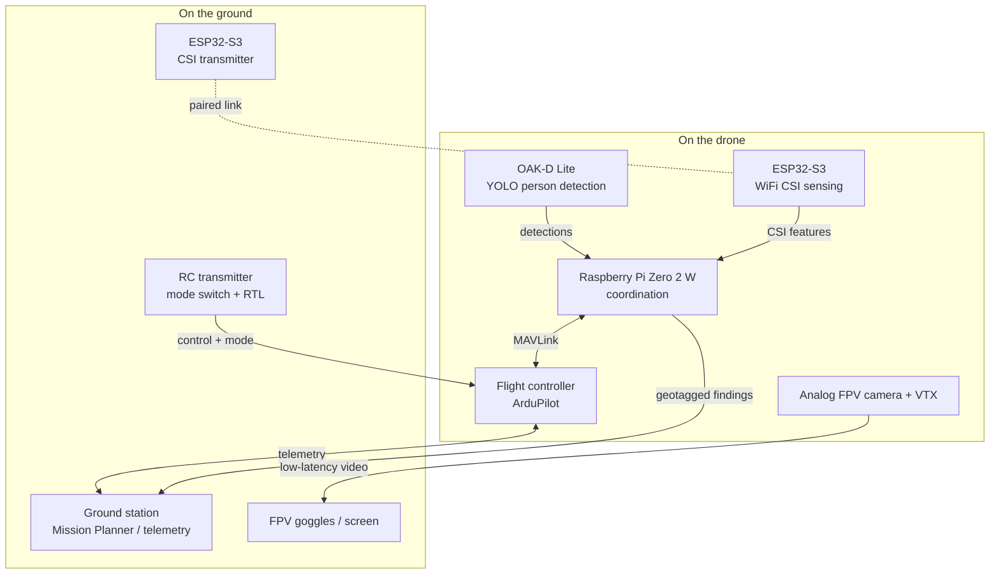

# Kestrel

**A low-cost, dual-mode search-and-rescue drone with onboard person detection (computer vision + WiFi sensing).**

> Final-year BSc Computer Science project, Griffith College Dublin (2026/27). Solo.

---

## Overview

Kestrel is a cheap quadcopter built to help locate people in emergencies - collapsed buildings, disaster zones, people lost in the field. It flies either on its own or under manual control, and in both cases an onboard perception stack flags where people are likely to be.

The guiding engineering principle is a clear division of labour between the autopilot, the human pilot, and the AI:

- **The human handles hard flying.** Tight, cluttered, "extreme" spaces are flown manually (FPV). People are still far better at this than any solo-built autonomy.
- **Autonomy handles the easy parts.** Open areas are covered by GPS waypoint missions with automatic return-to-home.
- **The AI never flies in the extreme - it looks.** In every mode the perception stack detects people (camera) and senses presence behind obstacles (WiFi), geotags findings, and after the flight produces a map of where people were detected.

This hand-off of control between AI and human is a form of **human-autonomy teaming (shared autonomy)**, which is the project's main research framing rather than "yet another autonomous drone".

---

## Key features

- Three flight modes on a single switch: stable autonomous, stable manual, and FPV manual.
- Onboard real-time person detection (YOLO on an OAK-D Lite).
- A second, independent detection channel using WiFi Channel State Information (CSI) to sense movement behind walls, used in a stationary "land-and-listen" step.
- GPS geotagging of every detection and a post-flight map of findings.
- Automatic return-to-launch (RTL) as a safety behaviour.

---

## Operating modes

Three modes on a 3-position transmitter switch. All three are stock ArduPilot modes - the autopilot runs the control laws, so this is configuration rather than custom code.

| Switch position | Mode | ArduPilot | Behaviour |
|---|---|---|---|
| 1 | Stable autonomous | `AUTO` | Flies a pre-planned waypoint mission; GPS keeps it stable |
| 2 | Stable manual | `ALT_HOLD` | Holds altitude and self-levels; pilot only steers |
| 3 | FPV manual | `ACRO` | No self-levelling, full rate control - true FPV feel |

**RTL (return-to-launch)** is not a fourth mode but a safety behaviour, mapped to a separate "panic" switch: one flick and the drone flies itself back to the launch point and hovers.

---

## Perception

Two detection systems that work very differently:

- **Computer vision - live, in flight.** An OAK-D Lite runs YOLO on-device, detects people, and overlays bounding boxes on a dedicated review video stream in real time. Used both autonomously (geotag a finding) and manually (highlight targets for the pilot).
- **WiFi CSI - stationary only.** Measures how a WiFi signal is distorted between two points; human movement and breathing change it. In flight the drone's own vibration drowns the weak signal, so this runs as a separate "land-and-listen" action: the drone lands, motors off, listens for 10-20 seconds, and reports movement / no movement behind a wall.

> Note on video latency: analog FPV video is near-zero-latency, which is what makes fast manual flight possible. Any computer that draws overlays onto the feed adds latency. Kestrel therefore keeps **two separate video channels** - a low-latency analog FPV feed for piloting, and a separate processed stream (OAK-D + overlays) for review. They are not mixed.

---

## Architecture

---

## Hardware

Estimated all-up weight: **~1.1-1.3 kg** (up to ~1.5 kg with wiring and mounts).

| Subsystem | Component | Notes |
|---|---|---|
| Airframe | 350-450 mm FPV quad frame, 4x 2212-2306 motors | Larger frame = more stable autonomy |
| Flight control | SpeedyBee F405 V4 stack (FC + 4-in-1 ESC) | ArduPilot-compatible; Matek H743 if more headroom needed |
| Power | 4S LiPo 4000-5000 mAh + BEC | Battery is the single heaviest part (~400 g) |
| Navigation | GPS/compass (M8N/M9N), SiK telemetry, RC Rx | |
| FPV video | Analog FPV camera + 5.8 GHz VTX + goggles/screen | For manual piloting, separate from the CV camera |
| Perception (CV) | Luxonis OAK-D Lite (fixed-focus) + Raspberry Pi Zero 2 W | OAK-D runs depth + YOLO on-device; Pi coordinates |
| Perception (WiFi) | 2x ESP32-S3-DevKitC-1U + external antenna | 1U variant has an external-antenna connector; CSI needs a Tx/Rx pair |

A full bill of materials with prices and a tiered budget (~760-1070 EUR for the complete build) is kept in the project's spec document.

---

## Software stack

| Layer | Tooling |
|---|---|
| Flight control | ArduPilot firmware; Mission Planner / QGroundControl for planning and RTL |
| Autopilot link | MAVLink via `pymavlink` or `MAVSDK-Python` |
| Person detection | YOLOv8n (Ultralytics), fine-tuned on the HERIDAL aerial SAR dataset |
| WiFi sensing | ESP-IDF (C++), CSI capture via `esp_wifi_set_csi_rx_cb`; lightweight classifier |
| Geotagging & map | Python; GPS read over MAVLink; post-flight map with Folium / Leaflet |
| Simulation | ArduPilot SITL (develop and test mission logic without hardware) |

Fine-tuning on HERIDAL matters because models trained on ordinary ground-level photos (COCO) detect people poorly from an aerial, top-down view. This is the project's main machine-learning contribution.

---

## Weight class and regulatory status (Ireland / EASA)

At ~1.1-1.3 kg, self-built (no C-class label), under 25 kg, Kestrel falls in the **Open category, subcategory A3**. Before any outdoor flight:

- Register as an operator on the IAA **MySRS** platform (required: camera onboard and weight over 250 g).
- Pass the online **A3** training and exam.
- Fly at least 150 m horizontally from residential, commercial, industrial, and recreational areas, away from uninvolved people.
- Stay below 120 m altitude and within visual line of sight. FPV goggles do not count as line of sight - an observer must keep the drone in unaided view alongside the pilot.

Rules can change; confirm current requirements on iaa.ie before flying. (This replaces any generic "check the regulations" note - the class itself is settled.)

---

## Status

Early planning. Concept, hardware selection, software stack, and the phased roadmap are defined; build has not started yet.

Planned phases: SITL simulation → build and learn to fly → autonomous waypoint mission + RTL → companion-computer link → live person detection → fine-tuning on aerial data → in-flight integration → findings map → (optional) WiFi module → final testing.

---

## Author

Vladimir Rainov - BSc Computer Science, Griffith College Dublin.
GitHub: [@PeGoPaz](https://github.com/PeGoPaz)
